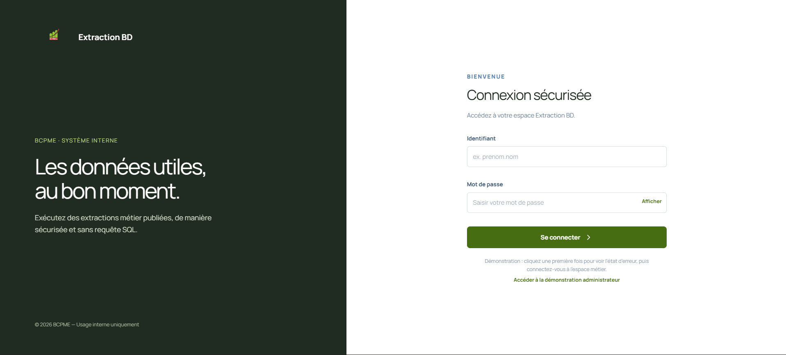
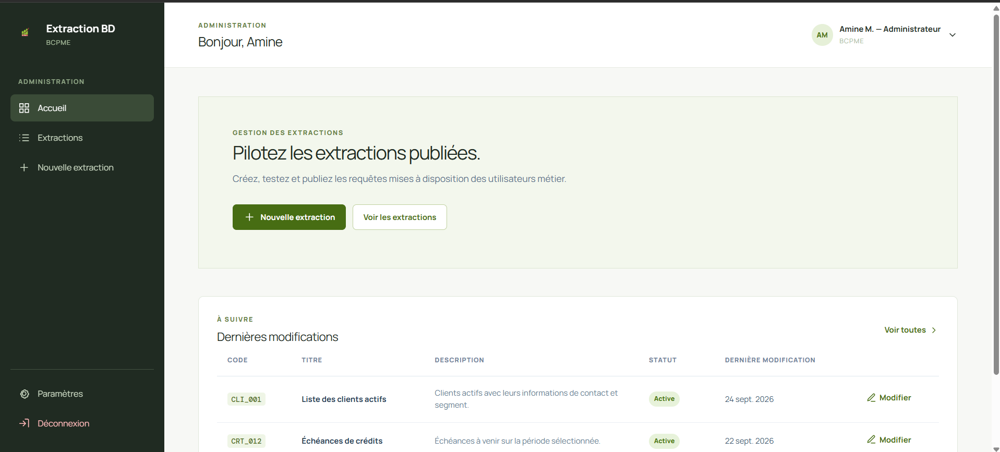
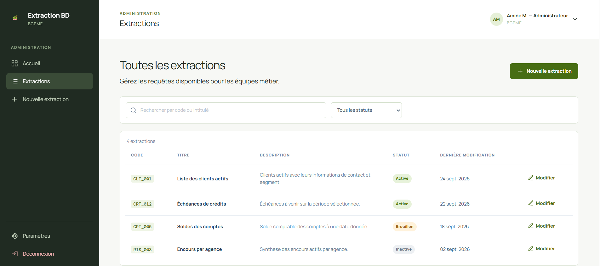
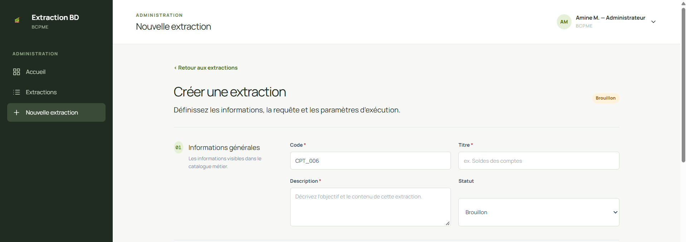
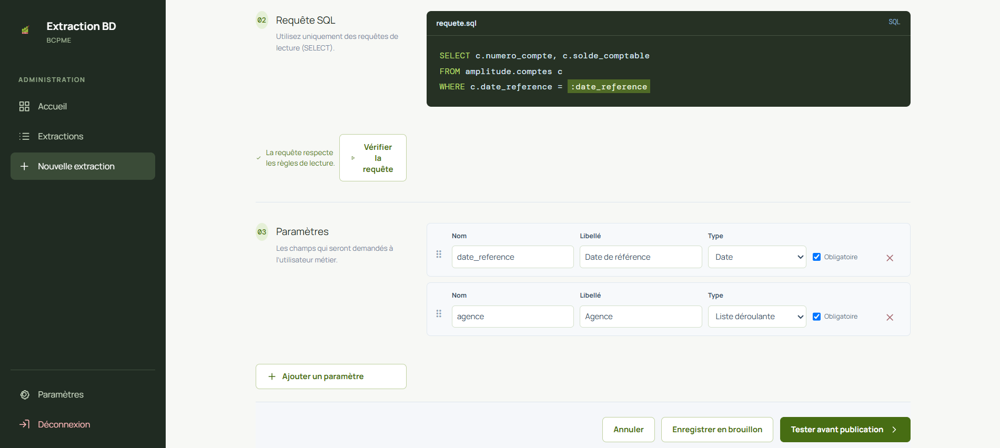
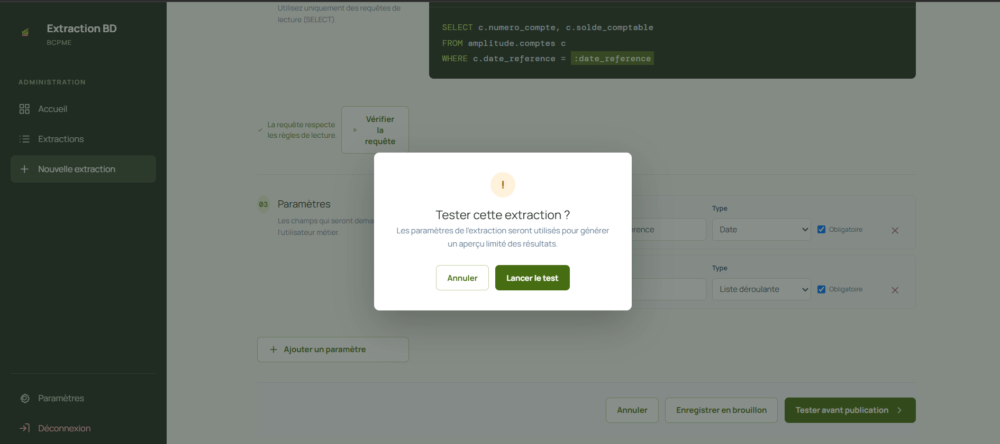
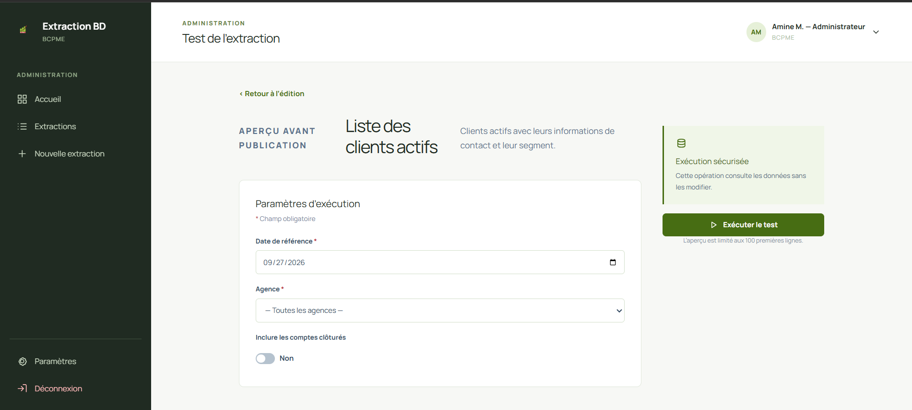
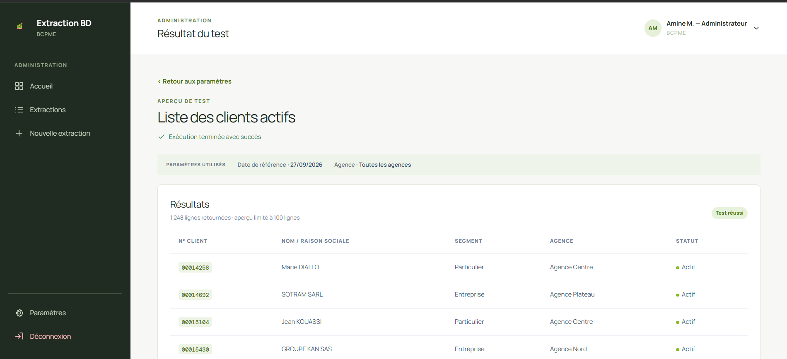
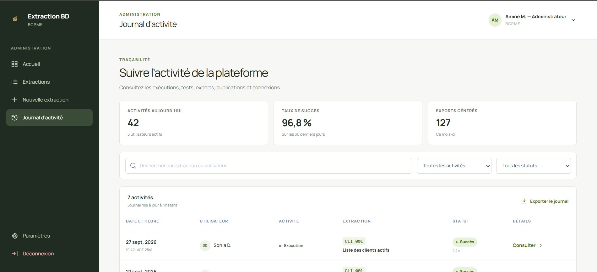
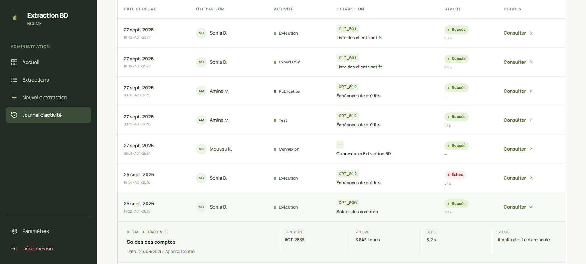

# Guide d'Utilisation — Espace Administrateur Technique

Ce guide s'adresse aux administrateurs techniques de la plateforme **Extraction BD** des BCPME. Il décrit pas à pas la gestion du catalogue d'extractions, le cycle de vie des requêtes, le test avant publication, ainsi que la surveillance du journal d'activité.

---

## Sommaire
1. [Accès et Authentification](#1-accès-et-authentification)
2. [Tableau de bord d'administration](#2-tableau-de-bord-dadministration)
3. [Gestion du Catalogue d'Extractions](#3-gestion-du-catalogue-dextractions)
4. [Créer ou Modifier une Extraction](#4-créer-ou-modifier-une-extraction)
5. [Tester et Publier une Extraction](#5-tester-et-publier-une-extraction)
6. [Désactiver ou Réactiver une Extraction](#6-désactiver-ou-réactiver-une-extraction)
7. [Surveillance du Journal d'Activité](#7-surveillance-du-journal-dactivité)
8. [Commandes d'Exploitation en Ligne de Commande](#8-commandes-dexploitation-en-ligne-de-commande)

---

## 1. Accès et Authentification

L'accès à l'espace technique s'effectue sur l'URL `/login`.



1. Saisissez votre identifiant technique (format `prenom.nom`, par exemple `kamga.eno`).
2. Saisissez votre mot de passe (sécurisé, minimum 12 caractères).
3. Cliquez sur **Se connecter**.

*Note de sécurité :* Après 5 tentatives infructueuses dans la même minute, le compte est temporairement verrouillé pendant 60 secondes pour contrer les attaques par force brute.

---

## 2. Tableau de bord d'administration

Une fois authentifié en tant qu'administrateur, vous êtes automatiquement redirigé vers le tableau de bord technique (`/admin`).



Le bandeau récapitulatif présente les métriques clés de la plateforme :
- **Nombre d'extractions actives** disponibles pour les métiers.
- **Extractions en brouillon** en attente de test ou de validation.
- **Volume d'exécutions journalières** et taux de succès.

Le menu latéral gauche permet d'accéder rapidement à :
- **Gestion des extractions** (`/admin/extractions`)
- **Journal d'activité** (`/admin/logs`)
- **Déconnexion** sécurisée.

---

## 3. Gestion du Catalogue d'Extractions

La liste complète des extractions est accessible via le menu **Extractions** (`/admin/extractions`).



Le tableau présente :
- Le **Code unique** (ex : `CPT_001`, `CRE_001`).
- Le **Titre** et la catégorie fonctionnelle (Comptes, Crédits, Opérations, Clients).
- Le **Numéro de version** incrémenté à chaque modification.
- Le **Statut** (`Actif`, `Brouillon`, `Désactivé`).
- Les **Actions rapides** : Modifier, Tester, Désactiver / Activer.

---

## 4. Créer ou Modifier une Extraction

Pour créer une nouvelle extraction, cliquez sur le bouton **+ Nouvelle extraction** en haut à droite. Pour en modifier une existante, cliquez sur **Modifier** sur la ligne correspondante.



### Étape 1 : Informations générales
- **Code de l'extraction** : identifiant alphanumérique majuscule court (ex: `CLI_002`), unique et non modifiable après création.
- **Titre fonctionnel** : libellé clair pour les utilisateurs métiers (ex: `Clients personnes morales par secteur d'activité`).
- **Catégorie** : regroupement métier.
- **Description détaillée** : objectif métier et périmètre des données.

### Étape 2 : Requête SQL et Paramètres



#### Règles de rédaction SQL (Garde-fou `SqlGuard`) :
1. **Uniquement des requêtes de lecture** : seules les instructions débutant par `SELECT` ou `WITH` sont acceptées.
2. **Aucun commentaire** : les commentaires `--` et `/* ... */` sont strictement rejetés par sécurité.
3. **Variables liées nommées** : tous les filtres dynamiques doivent utiliser la syntaxe `:nom_parametre`. Aucune valeur saisie par l'utilisateur ne doit être injectée directement dans le texte SQL.
4. **Dates** : les dates sont automatiquement converties en `TO_DATE(?, 'YYYY-MM-DD')` par le compilateur.

#### Déclaration des paramètres :
Chaque variable liée `:nom` dans le SQL doit avoir sa définition correspondante :
- **Nom technique** : correspondant au marqueur SQL (ex: `agence`, `date_debut`).
- **Libellé affiché** : étiquette conviviale pour l'utilisateur métier (ex: `Agence bancaire`).
- **Type** : `texte`, `entier`, `date` ou `liste`.
- **Obligatoire / Optionnel** : si optionnel, la clause SQL doit prévoir la neutralisation du filtre :  
  `(:agence IS NULL OR c.agence_id = :agence)`

---

## 5. Tester et Publier une Extraction

Conformément à la règle d'intégrité **D11 / D22**, **une extraction modifiée ou créée repasse obligatoirement au statut Brouillon**. Elle ne peut être publiée pour les utilisateurs métiers qu'après un test d'exécution réussi en direct sur la base.

### Lancement du test
Cliquez sur le bouton **Tester** depuis la liste ou depuis le formulaire.



L'écran de test vous invite à renseigner un jeu de paramètres réels pour valider la requête :



### Résultat du test et publication



L'écran de résultat affiche :
- Le temps d'exécution réel en millisecondes.
- Le total exact des lignes retournées (calculé via un `COUNT(*)` Oracle dédié).
- Un aperçu paginé des **100 premières lignes**.
- La confirmation que les formats de colonnes (dates, montants, codes) correspondent aux attentes.

**Bouton « Publier l'extraction » :**  
Si le test s'exécute avec succès, le bouton vert **Publier l'extraction** devient actif. Un clic applique immédiatement le statut `Actif` et rend l'extraction visible dans le catalogue des utilisateurs métiers.

---

## 6. Désactiver ou Réactiver une Extraction

Conformément à la décision **D10**, une extraction publiée n'est **jamais supprimée physiquement** du catalogue (pour préserver la traçabilité des journaux et la reproductibilité des exports) :

- Pour retirer une extraction du catalogue métier, cliquez sur l'action **Désactiver** dans la liste.
- L'extraction passe au statut `Désactivé` et disparaît instantanément de l'espace métier.
- Pour la remettre à disposition, cliquez sur **Réactiver**.

---

## 7. Surveillance du Journal d'Activité

Le journal complet d'activité est accessible sur `/admin/logs`.



Il comporte deux onglets :
1. **Onglet « Exécutions »** :
   - Horodatage précis (date et heure).
   - Utilisateur ayant exécuté l'extraction.
   - Extraction concernée (code et titre).
   - Mode d'exécution (Test, Exécution, Export CSV).
   - Statut (Succès / Échec), nombre de lignes retournées et durée en ms.
   - Bouton **Consulter** pour afficher le détail complet des paramètres saisis :



2. **Onglet « Connexions »** :
   - Historique des connexions réussies, échecs d'authentification, déconnexions et blocages temporaires avec adresse IP et navigateur.

**Export CSV du journal :**  
Le bouton **Exporter en CSV** permet de télécharger l'intégralité du journal d'audit pour les besoins du contrôle interne ou de la DOSI.

---

## 8. Commandes d'Exploitation en Ligne de Commande

Des commandes Artisan dédiées sont disponibles pour les opérations d'administration système :

### Création d'un utilisateur applicatif
```bash
php artisan app:creer-utilisateur --identifiant=pierre.d --prenom=Pierre --nom=Durand --role=admin --password=MotDePasseTresSecurise12!
```
*Le mot de passe doit comporter au moins 12 caractères.*

### Purge des résultats temporaires expirés
Les fichiers de résultats d'extraction sont automatiquement supprimés après 15 minutes. Pour forcer manuellement le nettoyage :
```bash
php artisan app:purge-resultats
```
*Cette commande est également planifiée automatiquement toutes les 15 minutes.*

### Lancement des vérifications de sécurité et de conformité
```bash
# Vérifier la conformité de l'ensemble des fonctionnalités
vendor\bin\phpunit --testsuite Unit,Feature

# Vérifier l'audit des dépendances
composer audit
npm audit
```
