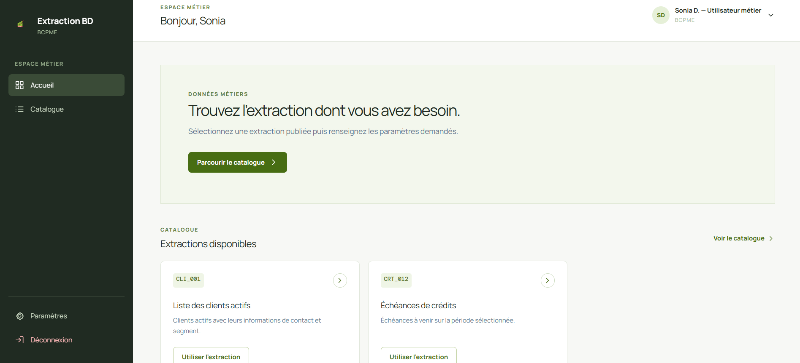
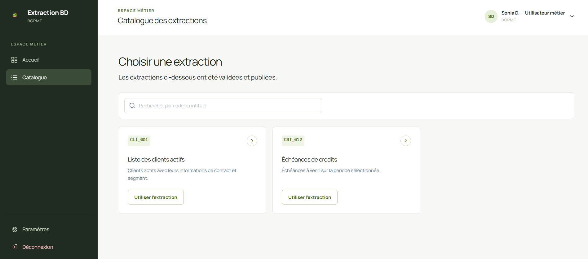
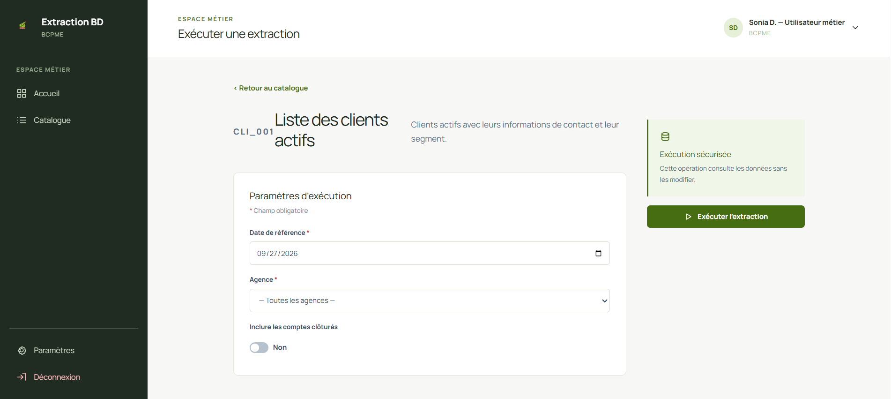
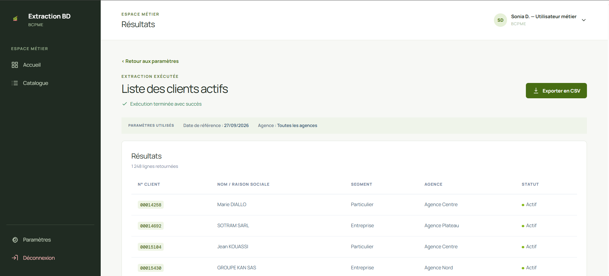
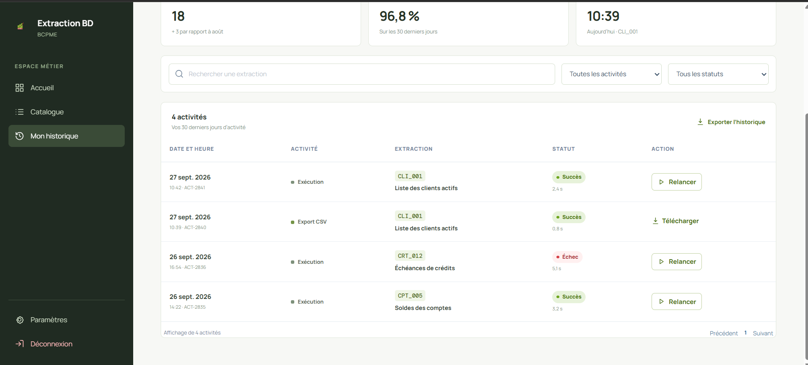

# Guide d'Utilisation — Espace Utilisateur Métier

Ce guide s'adresse aux collaborateurs et utilisateurs métiers des BCPME. Il vous explique comment rechercher, exécuter et exporter en toute autonomie les extractions de données mises à votre disposition par l'équipe technique, **sans avoir besoin d'écrire de requêtes SQL**.

---

## Sommaire
1. [Se connecter à l'application](#1-se-connecter-à-lapplication)
2. [Accueil de l'Espace Métier](#2-accueil-de-lespace-métier)
3. [Parcourir le Catalogue des Extractions](#3-parcourir-le-catalogue-des-extractions)
4. [Renseigner les Critères et Lancer une Extraction](#4-renseigner-les-critères-et-lancer-une-extraction)
5. [Consulter les Résultats et Exporter en CSV](#5-consulter-les-résultats-et-exporter-en-csv)
6. [Mon Historique : Retrouver et Relancer mes Extractions](#6-mon-historique--retrouver-et-relancer-mes-extractions)

---

## 1. Se connecter à l'application

Rendez-vous sur l'adresse fournie par votre administrateur (ex : `http://localhost:8000/login`).

1. Saisissez votre identifiant (ex : `sonia.d`).
2. Saisissez votre mot de passe personnel.
3. Cliquez sur **Se connecter**.

*Rappel de sécurité :* Ne partagez jamais vos identifiants. Chaque extraction et chaque export CSV réalisé est consigné dans le journal d'audit de la banque avec votre identifiant nominatif.

---

## 2. Accueil de l'Espace Métier

Après connexion, vous arrivez sur votre tableau de bord métier (`/dashboard`).

Cet écran vous présente :
- Un résumé de votre activité récente.
- Les extractions couramment utilisées au sein de votre établissement.
- Des liens directs vers le **Catalogue** et votre **Historique personnel**.

---

## 3. Parcourir le Catalogue des Extractions

Cliquez sur **Catalogue** dans le menu latéral gauche pour afficher l'ensemble des requêtes validées et publiées par l'équipe technique.

### Rechercher rapidement une extraction
Utilisez la barre de recherche en haut du catalogue :
- La recherche est instantanée : tapez un mot-clé (ex: `compte`, `crédit`, `échéance`), un code d'extraction (ex: `CPT_001`) ou un intitulé.
- La recherche est insensible à la casse et aux accents (taper `echeance` trouvera `Échéances`).

Chaque carte d'extraction vous présente son code, son titre explicite et sa description métier. Cliquez sur la carte souhaitée pour ouvrir le formulaire d'exécution.

---

## 4. Renseigner les Critères et Lancer une Extraction

Sur la fiche de l'extraction sélectionnée, un formulaire adapté aux besoins de la requête s'affiche :

### Types de champs à renseigner :
- **Listes déroulantes** : pour sélectionner une agence, une devise ou un statut de compte.
- **Dates** : calendrier interactif pour choisir votre période d'analyse (date de début et date de fin).
- **Champs texte ou numériques** : pour cibler un numéro de compte ou un identifiant client particulier.

*Astuce :* Les champs marqués d'un astérisque rouge `*` sont obligatoires. Les autres champs sont optionnels : laissez-les vides si vous souhaitez inclure l'ensemble des données sans filtre restrictif.

Cliquez ensuite sur le bouton principal **Exécuter l'extraction**.

---

## 5. Consulter les Résultats et Exporter en CSV

Dès la fin du traitement par le serveur de base de données, la page de résultats s'affiche :

### Les éléments de la page de résultats :
1. **Bandeau de confirmation** : indique le succès de l'opération, le nombre de lignes obtenues et la durée du traitement.
2. **Rappel des critères utilisés** : affiche en clair les filtres que vous avez sélectionnés (ex: `Agence : Agence Centre · Période : 01/01/2026 au 31/03/2026`).
3. **Tableau interactif des données** :
   - Pagination fluide (50 lignes par page) avec navigation *Précédent* / *Suivant*.
   - Colonnes alignées selon le type : montants alignés à droite avec séparateur de milliers, dates au format jour/mois/année (`JJ/MM/AAAA`), badges colorés pour les statuts.
4. **Plafond de sécurité (10 000 lignes)** :  
   Si votre requête retourne plus de 10 000 lignes, un message d'avertissement vous signale que le résultat a été tronqué pour préserver la mémoire. Affinez vos critères (par exemple en réduisant la période) pour cibler un volume plus précis.

### Télécharger en fichier Excel / CSV
Cliquez sur le bouton **Exporter en CSV** en haut à droite :
- Le fichier CSV téléchargé est immédiatement prêt à l'emploi.
- Il inclut la signature **UTF-8 BOM** garantissant l'ouverture automatique et sans déformation des caractères accentués dans **Microsoft Excel**.
- Les séparateurs sont normalisés au format point-virgule (`;`).

---

## 6. Mon Historique : Retrouver et Relancer mes Extractions

Accédez à votre historique personnel à tout moment via l'entrée **Mon historique** du menu latéral (`/mes-extractions`).

### Ce que vous apporte l'historique :
- **Vos statistiques personnelles** : nombre d'extractions lancées ce mois, exports réalisés, taux de succès.
- **Traçabilité complète** : date et heure de chacun de vos lancements, critères utilisés et nombre de lignes retournées.
- **Isolation garantie** : vous êtes le seul collaborateur à avoir accès à votre historique personnel. Les autres utilisateurs ne peuvent en aucun cas consulter vos activités.

### Relancer une extraction en 1 clic
Vous effectuez régulièrement la même extraction ?  
Dans le tableau de votre historique, cliquez sur le bouton **Relancer** en face d'une ligne précédente :
1. La page de l'extraction s'ouvre automatiquement.
2. Tous les critères que vous aviez saisis lors de votre précédent lancement sont **déjà pré-remplis**.
3. Il ne vous reste plus qu'à ajuster éventuellement une date et à relancer !

*(Si une extraction a été temporairement désactivée par l'administrateur, le bouton Relancer est grisé et une mention explicative vous en informe).*
